# Phase 2 supplement · Step 1: scene and route baseline

This checkpoint records the current implementation before changing source art or room geometry. It includes the in-progress Phase 3 inverted-room story route, while keeping the separate Phase 2 art tour isolated from story state.

## Route map

```mermaid
flowchart LR
    SR[Service Road<br/>official prologue exit] --> CW[Control Walkway<br/>fixed tower]
    CW -->|after on-site inversion<br/>implemented in Phase 3| IR[Inverted Room<br/>rotating wing]
    IR -. ladder route<br/>planned connector .-> MS[Maintenance Shaft<br/>fixed support frame]
    MS -. rescue platform<br/>planned connector .-> ER[Engine Room<br/>fixed service core]
    ER -. after restoration<br/>planned connector .-> OR[Observatory<br/>rotating wing]
    CW ==> |E art-tour transition| IR
    IR ==> |E art-tour transition| MS
    MS ==> |E art-tour transition| ER
    ER ==> |E art-tour transition| OR
```

Solid arrows are current story links; thin dotted arrows are planned story links; thick arrows are isolated art-tour transitions. The Control Walkway to Inverted Room story connection appears only after the inversion flag is set. The remaining story links are not playable yet. Art-tour transitions do not prove that the painted gaps are traversable.

## Scene inventory

### Control Walkway

- **Structure and pose:** fixed tower and bridge; the supported wing is separate and follows `PrologueState.castle_pose`. The in-progress Phase 3 step adds a lower hatch and duct entrance to the inverted room.
- **Current layers and moving parts:** far landscape, fixed tower/bridge, support ring, rotatable wing, dial and needle, short rail and front parapet; hatch art is an added route overlay.
- **Official walk area:** x=85–625, floor y=755. Preview right-edge transition is x=590; preview spawn x=430 from the previous scene and x=500 from the next.
- **Open concern:** the old elevated bridge still does not join Kath's deck. The new lower hatch is the current story connector; do not treat the bridge as a walkable path.

### Inverted Room

- **Structure and pose:** room shell rotates with the wing; the fixed tower outside stays upright. Current story entry is the lower hatch through the enclosed service duct, onto the old ceiling. Gravity-facing water and the hanging weight point screen-down.
- **Current layers and moving parts:** far exterior, room shell, split pipe, falling water, plumb chain/weight, fallen chair, chandelier, ladder, front parapet and lower-entry art.
- **Official walk area:** x=100–1470, floor y=806. Current story return hotspot is near x=145. Preview transitions are x=140 (back) and x=1410 (forward); preview entry spawns are x=260 or x=1300.
- **Open concern:** the visible maintenance ladder is inspectable but not yet a playable shaft exit. The art-tour edge at x=1410 is not the story route.

### Maintenance Shaft

- **Structure and pose:** fixed support frame; the distant wing can show the shared castle pose. The preview has a lower deck, upper receiving platform, winch, fixed and moving pulleys, anchor, rope, basket, brake, indicator and dock hardware.
- **Current layers and moving parts:** far wheelworks, fixed architecture, front occluders, winch drum, pulley/basket/rope rig, brake lever, load indicator, tool crate and receiving rail. Preview rig exposes art states and basket movement only.
- **Preview walk area and route:** lower deck floor y=790, preview route x=130–780, preview spawns x=260 or x=690. Erin's receiving ledge is around x=1215–1450, y=400–430; it is not Kath's walking floor.
- **Open concern:** the rope configuration is visually testable, but no story connector from the inverted-room ladder or onward rescue platform is active.

### Engine Room

- **Structure and pose:** fixed service core; the distant wing changes pose independently. Preview separates normal linkage, brake, stop signal, backup lock and obstruction states.
- **Current layers and moving parts:** far fixed tower, engine room architecture, front guardrail, linkage, brake, stop/normal signals, backup lock, jam debris, distant wing and service-threshold art.
- **Preview walk area and route:** floor y=725, bounds x=115–1555; left and right threshold markers are at x=120 and x=1550, y=725. Preview spawns are x=310 or x=1390.
- **Open concern:** threshold art and markers exist, but the adjacent playable platforms are not yet connected by final collision geometry.

### Observatory

- **Structure and pose:** part of the rotating wing; intended story access only after restoration. Telescope, drawer and readable document interface are independent of the room plate.
- **Current layers and moving parts:** restored exterior plate, selected transparent interior/floor regions, front parapet, telescope pivot, drawer and document sheet.
- **Preview walk area and route:** floor y=820, bounds x=155–1530; restored-wing marker at x=1510, y=820. Desk and telescope interaction points are at x=445 and x=810.
- **Open concern:** the exterior and selected interior alpha regions are not a fully independent window/parallax stack. The right edge still needs a visibly credible matching threshold before the story route opens.

## Cross-scene contracts and gaps

- **Character scale:** Kath is 301.6 px and Wick 130 px on the 1672×941 design canvas. Erin is approximately 308 px.
- **Pose contract:** `upright`, `tilted` (12°), `inverted` (180°), and `restored` (0°) remain distinct. Fixed support structures do not rotate with the wing.
- **Spawn rule:** each connected route needs paired visible thresholds and foot-position spawn markers. Keep art-tour spawn coordinates separate from story spawn markers.
- **Geometry not yet final:** all listed floors and bounds are current preview values. In particular, the inverted-room ladder, shaft landing, engine thresholds and observatory entrance need visual confirmation and final collision geometry before they become official exits.
- **Source art:** current delivery has separated PNG plates and placement notes, but no unified layered painting documents. Observatory parallax needs a camera-motion test before deciding whether to repaint its window stack.
- **State isolation:** the Phase 2 art tour may display alternate poses and prop states; it must not set story flags, notes, or spawn tags. The official inverted-room route is governed by Phase 3 story state.

## Review checklist for this checkpoint

- [ ] Confirm the route map distinguishes active story links from art-tour transitions.
- [ ] Confirm the listed current floor, bound, and marker coordinates match the project scenes.
- [ ] Confirm the maintenance shaft and observatory gaps are recorded as future connectors, not claimed complete.
- [ ] Preserve all pre-existing Phase 3 working-tree changes while proceeding to later checkpoints.
