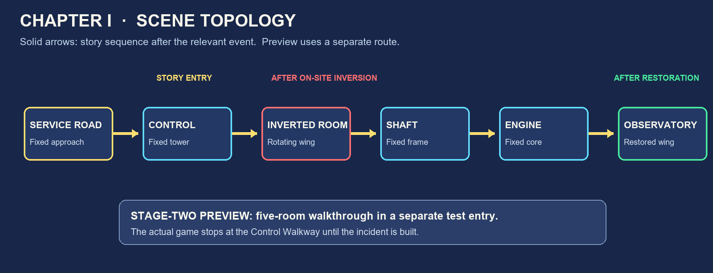

# Chapter I scene audit — checkpoint 1

This document fixes the visual and spatial contract before any scene painting or gameplay work. The five annotated layouts in `layouts/` use the original 1672 × 941 illustrations copied unchanged into `reference/`. Coordinates are image pixels and are **planning estimates**, not final collision shapes. The chapter script's “Nell” means **Kath** in the existing game. The approved visual baseline for implementation is now the five darker storybook images in `../storybook-original-scenes-v1/`; the older `reference/` images remain useful for spatial annotation only.

## Scene topology

| Room | Structure | Story entry and exit | Pose visible here | Later playtime capacity |
| --- | --- | --- | --- | --- |
| Control Walkway | Fixed central tower | Service Road → control deck; crossing into rotating wing only after the on-site incident | Exterior supported wing: tilted, then inverted, later restored | 3–4 min |
| Inverted Room | Rotating wing | Misaligned bridge/wing entry → old wall ladder into fixed lower service route | Interior is upside down; gravity remains screen-down | 4–5 min |
| Maintenance Shaft | Fixed support frame | Lower service route → shaft; high Erin ledge is reached by basket, not on foot | Distant wing may remain inverted | 8–9 min |
| Engine Room | Fixed service core | Rescue platform → machinery; exit to restored wing after testing locks | Mechanism progresses from inverted to restored | 4–5 min |
| Observatory | Rotating wing | Accessible only after the bridge and wing return to normal alignment | Restored | 2–3 min |

The standalone stage-two preview may visit all five rooms. The shipped story route still stops at the Control Walkway until the on-site inversion is implemented. Preview travel must not write story notes, open the story exits, or advance `PrologueState.castle_pose`.

## Visual contract

- Use the approved darker 2D storybook look: charcoal and ink-blue stone, rain-dark metal, muted copper/brass, sparse amber lamps, with peach dawn confined mainly to distant openings. Working palette: shadow `#182943`, stone `#314564`, mist `#4A628A`, aged brass `#9A7348`, lamplight `#E5B776`, warning red `#B45257`. Sample colors from `storybook-original-scenes-v1/` during painting; these swatches are guides rather than replacement colors. Keep the buildings and prop layout from those images instead of redesigning the rooms.
- Export each room at 1672 × 941 with **Far**, **Mid**, **Character**, and **Foreground** placement. Keep editable source layers and transparent game PNGs. Remove each detachable object from Mid and repaint the revealed background; a transparent cutout over the untouched composite would create a duplicate.
- Keep Kath's displayed height at 301.6 px and Wick's at 130 px. Plan Erin at about 308 px. All walkable surfaces must accommodate these silhouettes and a dialogue bubble at both 1672 × 941 and 1280 × 720.
- Green lines in the layouts are provisional foot paths, cyan markers are future interactables, yellow markers are exits or spawn points, and coral markers are art/geometry corrections. They are audit marks, not game graphics.

## Room-by-room layer and prop inventory

### 1. Control Walkway — `control-walkway.png`

**Far:** dawn skyline, mountains and river. **Mid:** fixed tower columns and deck, control console, ring support, wing seen through the opening. **Front:** near handrail, left machinery/gear silhouettes and any column crossing Kath's sprite.

Detach the wing and its pivot from the current composite; draw the exposed sky/ring behind it. Prepare pose-specific wing art for tilted/inverted/restored views, all aligned to a documented pivot. Detach the position needle, console lever and bridge connection. Reserve a fixed Erin station near the console and a speaking tube. The illustrated bridge is substantially higher than Kath's deck and does **not** currently provide a believable walking connection. Add a visible landing/stair/maintenance hatch in the art before implementing traversal. The fixed tower must not rotate with the wing.

Provisional safe foot span: x≈80–625 at y≈715–760. Story return to Service Road at the left. The bridge and wing are future destinations, not walkable by simply extending the horizontal floor.

### 2. Inverted Room — `inverted-room.png`

**Far:** outside fixed tower and sky seen through windows. **Mid:** overturned room shell, stable lower surface (the old ceiling), immovable furniture, upper old floor. **Front:** near bookcase/rail and debris that can cover Kath. Separate the roof seam/pipe, drops and splash, loose chair, hanging chains, plumb bob and wall ladder.

The currently lit fireplace is on the upper, former floor: extinguish it in the post-incident version. Make the broken water supply visibly begin in the former floor; drops, chain and plumb line all point to screen-down. The left opening and the route toward the fixed lower service platform are visually ambiguous; add a real wall ladder/door landing and a safe edge before gameplay. The old plan's “down” cannot be used as a collision rule.

Provisional foot span: x≈100–1530 at y≈805–835, to be broken at actual gaps after the art revision. Entry from the wing side and exit toward the lower fixed route need distinct spawn pads.

### 3. Maintenance Shaft — `maintenance-shaft.png`

**Far:** distant tower, wheelwork and water. **Mid:** fixed lower/upper platforms, structural beam and winch base. **Front:** near parapet, chain and foliage. Detach the winch drum, brake, one upper fixed pulley, basket-mounted moving pulley, anchor, both rope runs, basket, load indicator, deformable rail, dock catches and Erin's high ledge.

The composite currently suggests a rope path but does not cleanly depict both required configurations. Rebuild the **tool configuration** as one fixed pulley and the **passenger configuration** as an anchored rope through the basket pulley and back over the fixed pulley to the winch. Leave room for the basket to move without intersecting the upper ledge. The basket needs empty/tool/person/docked visuals; ropes must connect to actual attachment points. The upper-right ledge is intentionally inaccessible to Kath on foot.

Provisional lower foot span: x≈80–820 at y≈785–805. Erin's high ledge is around x≈1210–1600 at y≈445–470; it is an NPC/basket destination, not part of the lower foot path.

### 4. Engine Room — `engine-room.png`

**Far:** exterior fixed tower, support ring and dawn. **Mid:** engine housing, station diagram, operator platform and pipes. **Front:** continuous near guardrail and gear silhouettes. Detach the normal-position linkage, stop-signal indicator, brake, independent inverted-position lock, water/debris obstruction and repair state parts.

The current wall picture explains the test station but the cause of failure is not visually identifiable. Give the normal-position rod a definite travel path and a removable obstruction; show the separate backup lock on a different support. Mark signal, brake and lock as distinct mechanisms rather than one generic lever. The window view must follow the shared pose while fixed architecture stays upright.

Provisional foot span: x≈75–1570 at y≈635–675, behind the foreground rail. Lower service entry is left; restored-wing exit is right and remains story-locked until repair. Neither opening is a clear door in the reference, so both need painted thresholds before the scene can be connected.

### 5. Observatory — `observatory.png`

**Far:** dawn coast and distant structures. **Mid:** bookcases, telescope support, drawers, charts and floor. **Front:** near rail, large lower-right instrument and foliage. Detach the file drawer, signed work record, Floating Isles comparison slip and WITHDRAWN sheet. Render legible English document text in Godot close-ups rather than baking it into the image.

The room belongs to the rotating wing and should be entered only after restoration in the story. Ensure its view through the windows, floor and door correspond to that orientation. Distant floating islands may remain as a later-region tease, but should not imply this observatory itself floats.

Provisional foot span: x≈100–1560 at y≈825–855. Place the restored-wing entry on the right, with the records in reachable left/middle positions. The current right edge is an open railing, not an interior doorway; redraw a credible threshold and its matching exterior approach.

## Cross-scene omissions to resolve before later checkpoints

1. The five source illustrations are flattened; there are no editable separated layers or repaired backgrounds yet. This is the largest art-production task, not a simple alpha-mask export.
2. Erin has no reusable game sprite. Create her in checkpoint 2 before approving the control-deck composition.
3. The control-deck bridge/wing entry, inverted-room exit, and engine/observatory thresholds lack credible walkable connectors. Resolve these in painted architecture, then choose final spawn anchors; do not hide the gaps with scripted teleports in the story route.
4. The shaft needs technically consistent fixed/moving pulley and rope states. Validate the route at diagram level before detailed painting so the later puzzle does not require redrawing the scene.
5. Keep the 12° tilted pose and 180° inverted pose distinct. Stage-two preview may choose a pose for visual inspection; it must not imply the on-site inversion already happened in the shipped route.
6. All five layouts have perspective floors. Final Godot foot lines/collision boundaries should be measured after layer repair, not copied from the provisional pixel estimates above.

## Checkpoint-1 acceptance

Review the five annotated PNGs, the topology diagram and this inventory. Approving this checkpoint authorizes the next planned step: Erin and common visual assets. No chapter gameplay or original illustration has been modified here.
